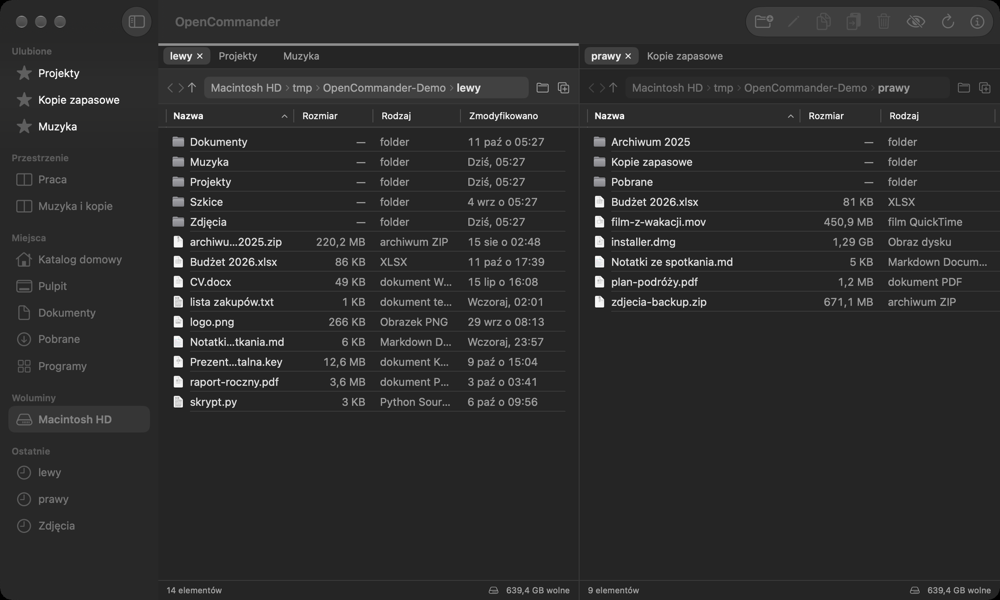
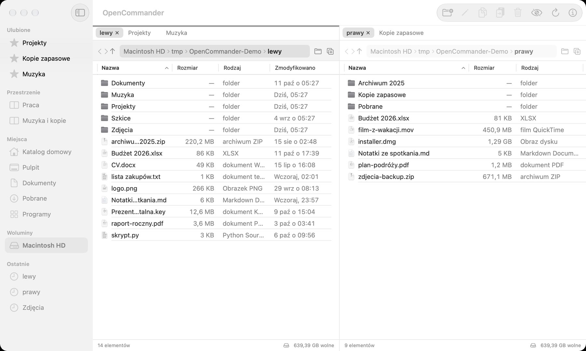

# OpenCommander

> 🇬🇧 English version: [README.md](../README.md)

**Natywny, dwupanelowy menedżer plików na macOS** (SwiftUI + AppKit), open source — pliki lokalne oraz serwery **SFTP, FTP, FTPS i WebDAV** w tych samych panelach.
*(EN: a native dual-pane file manager for macOS with local files plus SFTP, FTP, FTPS and WebDAV. UI language: Polish.)*

<p align="center">
  <br>
  
</p>

> **Zakres:** pliki lokalne oraz — na jawne żądanie użytkownika — serwery SFTP, FTP, FTPS i WebDAV (zob. [Połączenia sieciowe](#połączenia-sieciowe)). Aplikacja niczego nie wysyła „do domu” i nie zbiera żadnych danych; łączy się wyłącznie z serwerami, które sam dodasz.

## Status
Wczesna wersja **0.1**. Logika plikowa jest pokryta testami automatycznymi (SwiftPM, wyłącznie na katalogach tymczasowych), ale **interfejs jest sprawdzany ręcznie** — lista rzeczy do przeklikania jest w [MANUAL_TESTS.md](pl/MANUAL_TESTS.md). Spodziewaj się błędów; zgłaszaj je przez Issues. Interfejs jest po polsku (bez systemu lokalizacji).

Aplikacja **nie jest notaryzowana** ani podpisana certyfikatem dewelopera — zbuduj ją ze źródeł (poniżej). Działa bez sandboxa i bez Full Disk Access (uzasadnienie: [ARCHITECTURE.md](pl/ARCHITECTURE.md)).

Niektóre pliki są chronione przez macOS (np. odebrane w Wiadomościach lub przez AirDrop) i aplikacja bez Pełnego dostępu do dysku nie może ich przenieść do Kosza. Wtedy OpenCommander prosi o to Finder (zgoda na Automatyzację, tylko woluminy lokalne); możesz też sam nadać Pełny dostęp do dysku.

## Funkcje
**Przeglądanie**
- Dwa niezależne panele; **karty** w każdym (⌘T, do 10 na panel) i **przestrzenie robocze** (zapis/przywracanie kart obu paneli).
- Tabela z wielokrotnym zaznaczaniem i sortowaniem, okruszki ścieżki, historia, przeciągany separator paneli, konfigurowalne kolumny.
- Pasek boczny: ulubione, miejsca, woluminy (z przyciskiem **wysuń** dla USB/kart/obrazów dysków — dysk systemowy nigdy), ostatnie lokalizacje.
- **Szukanie (⌘F)** po nazwie w folderze i podfolderach (bez rozróżniania wielkości liter i polskich znaków), Quick Look na Spacji, panel informacji (⌘I) z rozmiarem folderu liczonym tylko na żądanie.
- Automatyczne odświeżanie po zmianach w otwartym folderze.

**Operacje na plikach**
- Kopiowanie, przenoszenie, zmiana nazwy, nowy folder, Kosz; **schowek plików** (⌘C / ⌘V, także do i z Findera) oraz **przeciąganie** między panelami i z Findera.
- Kolejka operacji z paskiem postępu na żywo (bajty, prędkość, szacowany czas do końca), anulowanie także w środku dużego pliku.
- Dialog konfliktów: pomiń / zachowaj obie / zastąp (zastąpiony element trafia do Kosza).

**Narzędzia**
- **Zbiorcza zmiana nazw** (⇧⌘R) z podglądem „przed → po” i blokadą kolizji.
- **Porównanie folderów** (⇧⌘K) po nazwie, rozmiarze i dacie, z kopiowaniem różnic.
- **Wyszukiwanie duplikatów** po zawartości (SHA-256) — uruchamiane wyłącznie na żądanie; usuwanie tylko do Kosza i zawsze z zachowaniem jednej kopii.

Pełna lista skrótów: menu **Pomoc → Skróty klawiszowe** (⇧⌘/) oraz tabela poniżej.

## Połączenia sieciowe
Sekcja **Połączenia** w pasku bocznym (⌥⌘K — menedżer połączeń). Każdy panel niezależnie pokazuje folder lokalny albo lokalizację na serwerze; kopiowanie między nimi (F5, przeciąganie, ⌘V) to wysyłanie lub pobieranie przez zwykłą kolejkę operacji.

**Jak dodać połączenie:** pasek boczny → **＋** przy „Połączenia” (albo menu *Połączenia → Nowe połączenie…*) → wybierz protokół, wypełnij pola, **Testuj połączenie**, **Zapisz**. Kliknięcie połączenia w pasku bocznym łączy i otwiera katalog początkowy w aktywnym panelu.

| | SFTP | FTP | FTPS (jawny/niejawny) | WebDAV |
|---|---|---|---|---|
| Szyfrowanie | SSH | **brak** (wymaga jawnej zgody w profilu) | TLS 1.2+, weryfikacja certyfikatu i nazwy hosta | HTTPS (HTTP tylko po jawnej zgodzie, z ostrzeżeniem) |
| Logowanie | hasło, klucz (Ed25519/RSA, także z hasłem do klucza) | hasło, anonimowo | hasło, anonimowo | hasło (Basic/Digest), anonimowo |
| Lista, pobieranie, wysyłanie | ✅ | ✅ (MLSD; zapasowo LIST — heurystyka) | ✅ | ✅ |
| Nowy folder, zmiana nazwy, usuwanie | ✅ | ✅ | ✅ | ✅ |
| Wznawianie przerwanych transferów | ❌ | ❌ | ❌ | ❌ |
| Przenoszenie lokalne ↔ zdalne | ❌ (tylko kopia) | ❌ | ❌ | ❌ |
| Kopiowanie serwer → serwer | ❌ | ❌ | ❌ | ❌ |
| Weryfikacja serwera | odcisk klucza (pytanie przy pierwszym połączeniu, blokada przy zmianie) | — | certyfikat TLS | certyfikat TLS |

Co to oznacza w praktyce:
- **Usuwanie na serwerze nie jest Koszem.** Aplikacja pyta osobno i pokazuje serwer, folder i liczbę elementów; może być nieodwracalne.
- **Nic nie jest nadpisywane domyślnie.** Konflikt: pomiń / zachowaj obie / zastąp (zastąp na serwerze nadpisuje plik bez Kosza — dialog to mówi). Zastąpienie *folderu* na serwerze jest zablokowane.
- Wysyłanie idzie przez nazwę tymczasową `.opencommander-tmp-…` i zmianę nazwy po sprawdzeniu rozmiaru; przerwany lub anulowany transfer nie zostawia pliku, który wyglądałby na kompletny. **Ponów** (przy nieudanej operacji) zaczyna dany element od początku — niczego nie ponawiamy automatycznie.
- Źródło lokalne nie jest usuwane po wysłaniu. Dowiązania symboliczne na serwerze nie są rozwijane ani kopiowane.
- Nazwy plików z serwera są niezaufane: nazwy ze `/`, `..` albo znakami sterującymi są odrzucane (ochrona przed path traversal i wstrzykiwaniem poleceń FTP).

### Sekrety i zaufanie
- **Hasła i hasła do kluczy trafiają wyłącznie do Keychain** (rodzaj „generic password”, `ThisDeviceOnly`, bez synchronizacji iCloud). Profil połączeń (UserDefaults, JSON) zawiera tylko konfigurację i anonimowy identyfikator sekretu — nigdy hasło, passphrase ani zawartość klucza (dla klucza prywatnego zapisujemy tylko ścieżkę do pliku).
- Odznacz „Zapamiętaj hasło w Keychain”, a hasło będzie żyło tylko w pamięci do rozłączenia lub zamknięcia aplikacji.
- Usuwając profil, wybierasz, czy usunąć też jego sekrety z Keychain; sekret używany przez inny profil nigdy nie jest usuwany.
- Błędy i komunikaty przechodzą przez maskowanie (hasła, tokeny, nagłówki Authorization/Cookie, adresy z danymi logowania, bloki kluczy PEM). Aplikacja niczego nie loguje na dysk.
- **SFTP:** przy pierwszym połączeniu widzisz host, port, typ klucza i odcisk SHA256; zaufanie jest zapisywane dopiero po Twojej zgodzie. **Zmieniony klucz blokuje połączenie bez pytania.** Lista zaufanych serwerów (podgląd/usuwanie): *Połączenia → Zaufane serwery SSH*. To własny plik aplikacji, **nie** pełna obsługa `~/.ssh/known_hosts` (bez zahaszowanych nazw, wzorców, certyfikatów i `@revoked`).
- **FTPS:** brak „akceptuj wszystko” — niezaufany lub niepasujący certyfikat kończy połączenie, a serwer bez TLS nigdy nie powoduje cichego przejścia na zwykłe FTP (hasło nie jest wtedy wysyłane). **WebDAV:** bez przekierowań na inny host, bez obniżania HTTPS→HTTP, poświadczenia tylko do hosta z adresu bazowego.

### Ograniczenia połączeń
- Transfery nie są wznawiane; SFTP przesyła dane sekwencyjnie po 32 KiB, więc przy dużym opóźnieniu jest wolniejszy niż klient OpenSSH.
- SFTP: biblioteka Citadel czyta klucze Ed25519 i RSA w formacie OpenSSH (nie ECDSA, nie starszy format PEM); korzysta z forka `swift-nio-ssh` (zob. [ARCHITECTURE.md](pl/ARCHITECTURE.md)).
- FTP: bez MLSD czasy z `LIST` są przybliżone (brak roku w starszych wpisach), a nietypowe formaty list są pomijane i liczone, nie zgadywane. Jedno połączenie, operacje szeregowo. Kodowanie nazw: UTF-8.
- WebDAV: bez blokad (LOCK) i PROPPATCH; przy Digest treść PUT może zostać wysłana dwukrotnie (po wyzwaniu serwera). Plików ze zdalnego panelu nie otwiera się bezpośrednio — skopiuj je na dysk.
- Pliki zdalne nie mają Quick Look, „Pokaż w Finderze” ani ulubionych; zbiorcza zmiana nazw, porównanie i duplikaty działają tylko lokalnie.
- Zdalny listing odświeża się ręcznie (⌘R) i po własnych operacjach — nie ma obserwatora zmian na serwerze.
- macOS może zapytać o dostęp do sieci lokalnej przy łączeniu z urządzeniami w LAN.
- Jeśli serwer zerwie połączenie, następna akcja łączy ponownie (z pytaniem o hasło, gdy nie jest zapisane); przerwane operacje trzeba ponowić ręcznie.

### Testy z serwerami (bezpiecznie)
Testy automatyczne łączą się **wyłącznie z serwerami uruchamianymi w procesie testowym na 127.0.0.1** (katalogi tymczasowe, certyfikaty generowane na czas testu) — nigdy z serwerami publicznymi ani Twoimi. `swift test` pokrywa: SFTP (hasło, nieznany/zmieniony klucz hosta, zerwanie, anulowanie, Unicode), WebDAV (odpowiedzi 207, przestrzenie nazw, prefiks ścieżki, przekierowania, uwierzytelnianie, nieprawidłowy certyfikat), FTP (MLSD/LIST, tryb pasywny, zerwanie) i FTPS jawny/niejawny (weryfikacja certyfikatu i hosta, brak obniżania). Testy FTPS jawnego używają `python3` i `openssl` z systemu (pomijane, gdy ich brak).
Do ręcznego sprawdzenia interfejsu możesz uruchomić lokalny serwer SFTP testowy: `OC_SERVE_SECONDS=300 swift test --filter SFTPIntegrationTests/testServeForManualUI` (nasłuch `127.0.0.1:2222`, użytkownik `ola`, hasło z `TestSFTPServer`), a w aplikacji — **kopii z innym identyfikatorem pakietu** (zob. [CLAUDE.md](pl/CLAUDE.md)) — dodać profil SFTP na ten adres.

### Biblioteki i licencje
| Komponent | Do czego | Licencja |
|---|---|---|
| [Citadel](https://github.com/orlandos-nl/Citadel) 0.12.1 | SFTP/SSH | MIT |
| [swift-nio-ssh](https://github.com/Wellz26/swift-nio-ssh) 0.3.7 (fork używany przez Citadel) | SSH | Apache-2.0 |
| swift-nio, swift-log, swift-crypto, swift-asn1, swift-atomics, swift-collections, swift-system (Apple) | zależności tranzytywne | Apache-2.0 |
| [BigInt](https://github.com/attaswift/BigInt) 5.7.0 | zależność tranzytywna | MIT |
| libcurl (systemowa, `libcurl.4.dylib`) | FTP/FTPS (TLS przez SecureTransport) | licencja curl — biblioteka systemu, nie jest dołączana do aplikacji |
| `URLSession`, `XMLParser`, Keychain, Network.framework | WebDAV, XML, sekrety | część macOS |

Wersje są przypięte w `Package.swift` (Citadel `exact`) i `Package.resolved`. SSH, TLS i kryptografia nie są implementowane we własnym zakresie.

## Bezpieczeństwo danych
- Nic nie jest nadpisywane domyślnie; usuwanie lokalne z poziomu UI to zawsze Kosz (na serwerze: osobne, jawne potwierdzenie — zob. wyżej).
- Przy przenoszeniu między woluminami źródło jest usuwane dopiero po udanej kopii; kopiowanie folderu do samego siebie jest blokowane; dowiązania symboliczne są kopiowane jako dowiązania.
- Pliki tymczasowe są rejestrowane w dzienniku — po przerwanej sesji niedokończone kopie są sprzątane, a elementy przerwane w trakcie przenoszenia **przywracane**, nie kasowane.
- Rozmiary folderów i skróty zawartości są liczone tylko po akcji użytkownika; listowanie nie czyta zawartości plików.

Szczegóły i zasady dla współtwórców: [CLAUDE.md](pl/CLAUDE.md#zasady-bezpieczeństwa-operacji).

## Wymagania i budowanie
macOS 14.4+ (minimalny rozmiar okna 900 pt), Xcode 15+ (rozwijane na Xcode 27 / Swift 6.4).

```bash
# testy logiki (SwiftPM)
swift test --scratch-path /tmp/oc-spm

# aplikacja
xcodebuild -project OpenCommander.xcodeproj -scheme OpenCommander \
  -destination 'platform=macOS' -derivedDataPath /tmp/oc-dd build
open /tmp/oc-dd/Build/Products/Debug/OpenCommander.app
```
Projekt Xcode jest generowany z `project.yml` ([XcodeGen](https://github.com/yonaskolb/XcodeGen)); `OpenCommander.xcodeproj` jest w repozytorium, więc XcodeGen nie jest potrzebny do zwykłego budowania.
Jeśli repozytorium leży w folderze synchronizowanym z iCloud (np. Documents), podpisywanie może zgłosić „detritus” — buduj z `-derivedDataPath` poza tym folderem, jak wyżej.

## Skróty klawiszowe
| Skrót | Akcja |
|---|---|
| Tab, ⌘` | przełącz panel |
| Enter, ⌘↓ | otwórz |
| ⌘↑ / ⌘[ / ⌘] | folder nadrzędny / wstecz / dalej |
| ⌘R | odśwież |
| ⇧⌘N / ⇧⌘O | nowy folder / wybierz folder |
| F2 | zmień nazwę |
| F5 / F6 | kopiuj / przenieś do drugiego panelu |
| ⌘C / ⌘V (też ⌥C / ⌥V) | kopiuj / wklej pliki |
| ⌥⌘C | kopiuj ścieżkę |
| ⌘⌫ | do Kosza (z potwierdzeniem) |
| ⌘E | wysuń wolumin aktywnego panelu |
| ⌥⌘R | pokaż w Finderze |
| ⌘F | szukaj w folderze i podfolderach (Esc zamyka) |
| Spacja | szybki podgląd |
| ⌘I | panel informacji |
| ⇧⌘. | pliki ukryte |
| ⌘D | dodaj/usuń folder z ulubionych |
| ⌘T / ⌘W | nowa karta / zamknij kartę (ostatnia karta panelu zamyka okno) |
| ⇧⌘] / ⇧⌘[ | następna / poprzednia karta |
| ⌥⌘S | zapisz przestrzeń roboczą |
| ⇧⌘R | zbiorcza zmiana nazw |
| ⇧⌘K | porównaj foldery |
| ⇧⌘/ | lista skrótów |

Klawisze F wymagają Fn albo włączonej opcji „Używaj klawiszy F1, F2 itd. jak standardowych”; wszystkie akcje są też w menu.

## Znane ograniczenia
- W wąskich panelach (np. przy otwartym panelu informacji) kolumny „Rodzaj” i „Zmodyfikowano” mogą się ucinać — widoczność kolumn zmienisz prawym kliknięciem na nagłówku tabeli albo poszerz panel przeciągając separator.
- Automatyczne odświeżanie widzi zmiany bezpośrednio w otwartym folderze, nie w podfolderach ani w zawartości plików.
- Zbiorcza zmiana nazw odrzuca zamiany i łańcuchy nazw (a→b, b→a) zamiast je obsługiwać.
- Plan prac i to, czego jeszcze nie ma: [ROADMAP.md](pl/ROADMAP.md).

## Współtworzenie
Zob. [CONTRIBUTING.md](pl/CONTRIBUTING.md). Logika plikowa musi mieć testy na katalogach tymczasowych; testy sieciowe tylko na serwerach lokalnych w procesie testowym.

## Licencja i autorstwo
MIT — zob. [LICENSE](../LICENSE). Ikona aplikacji: [Tools/icon](../Tools/icon/README.md) (zaprojektowana z użyciem skilla [logo-design](https://github.com/kaankiziltug/logo-design-skill), MIT).
